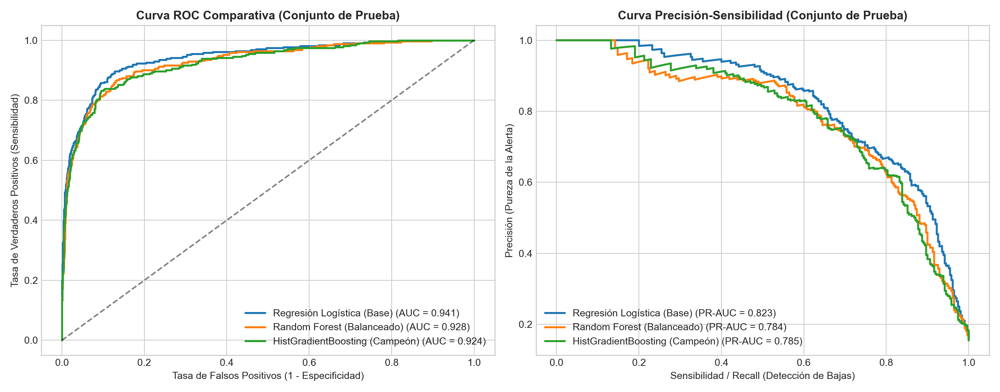
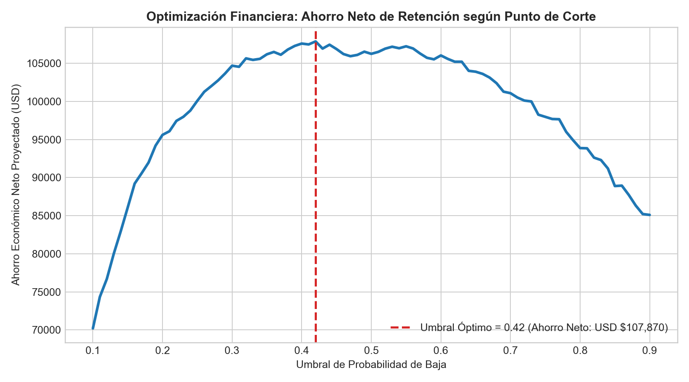
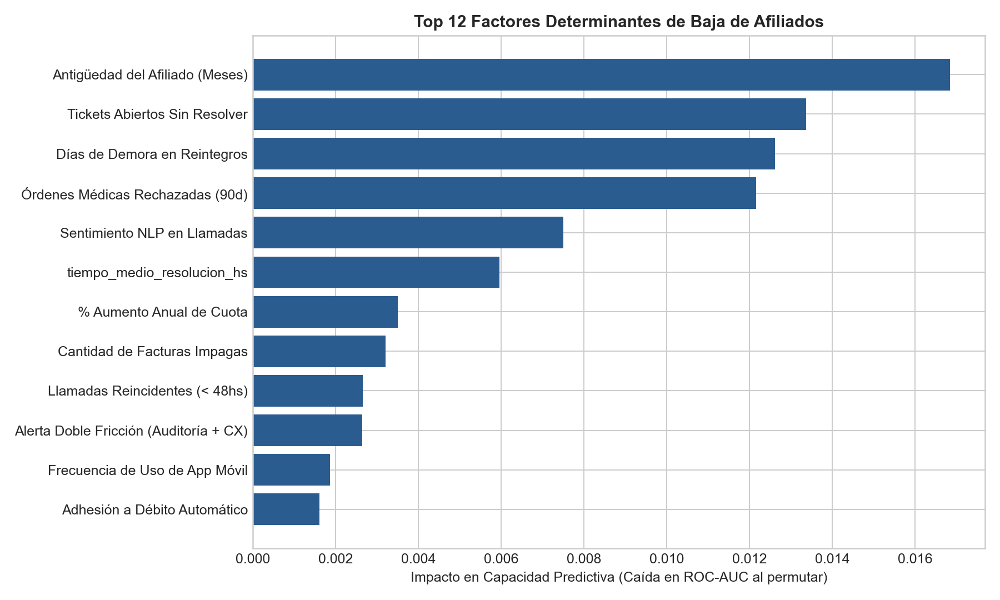
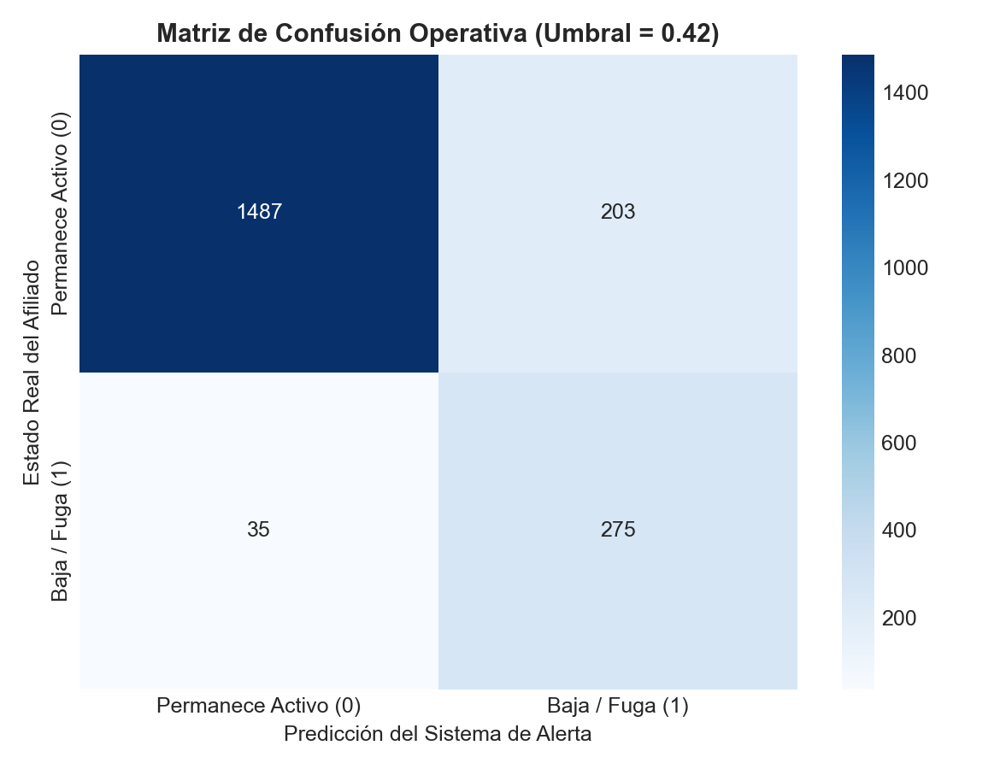

# 🏥 Healthcare Member Churn Prediction & Prescriptive Retention Engine

[](https://www.python.org/)
[](https://scikit-learn.org/)
[](https://pandas.pydata.org/)
[](#)
[](#)

Sistema integral de **Data Science y Analítica Prescriptiva** diseñado para Obras Sociales, Prepagas y Aseguradoras de Salud. El proyecto aborda la fuga de afiliados (*Member Churn*) integrando fuentes relacionales de **Auditoría Médica, Contact Center (VoC / CX), Facturación y Padrón**, optimizando el punto de corte del modelo según el impacto financiero real (LTV vs. costo de retención) y asignando automáticamente la **Mejor Acción Siguiente (*Next-Best-Action*)** para el equipo de retención.

---

## 📋 Tabla de Contenidos

1. [Contexto de Negocio y Problemática en Salud](#-1-contexto-de-negocio-y-problemática-en-salud)
2. [Arquitectura de Datos Relacional y Feature Engineering](#-2-arquitectura-de-datos-relacional-y-feature-engineering)
3. [Metodología de Modelado y Optimización Financiera](#-3-metodología-de-modelado-y-optimización-financiera)
4. [Resultados Visuales y Evaluación Técnica](#-4-resultados-visuales-y-evaluación-técnica)
5. [Motor Prescriptivo (Next-Best-Action) para CRM](#-5-motor-prescriptivo-next-best-action-para-crm)
6. [Estructura del Repositorio](#-6-estructura-del-repositorio)
7. [Instrucciones de Ejecución (Quickstart)](#-7-instrucciones-de-ejecución-quickstart)

---

## 🎯 1. Contexto de Negocio y Problemática en Salud

En el sector de obras sociales y medicina prepaga, la baja voluntaria o traspaso de obra social rara vez ocurre por un único evento aislado. Es el resultado acumulado de **fricciones asistenciales y administrativas**:

- **Fricción en Auditoría Médica:** Rechazos de prácticas médicas, estudios diagnósticos observados o tiempos de respuesta (*Turnaround Time - TAT*) mayores a 48 horas.
- **Falla en el Contact Center (Bajo FCR):** Afiliados que deben comunicarse reiteradas veces en ventanas de 48 horas por el mismo reclamo sin resolución efectiva.
- **Fricción Financiera:** Demoras mayores a 45 días en la liquidación de reintegros o incrementos de cuota/copagos que erosionan la percepción de valor.

### ¿Qué resuelve este sistema?

1. **Anticipación:** Detecta afiliados con alta probabilidad de baja con 30 a 60 días de antelación.
2. **Optimización de Presupuesto:** En lugar de usar un umbral arbitrario de probabilidad (`0.50`), calcula matemáticamente el umbral que **maximiza el ahorro neto en dólares** considerando el *Lifetime Value (LTV)* del afiliado y el costo operativo de la célula de retención.
3. **Accionabilidad Operativa:** Clasifica la causa raíz de insatisfacción de cada afiliado y prescribe el protocolo exacto que debe ejecutar el supervisor de CX o auditoría médica.

---

## 🗄️ 2. Arquitectura de Datos Relacional y Feature Engineering

El pipeline simula e ingesta un ecosistema de **10.000 afiliados** distribuido en **4 tablas relacionales** dentro de `data/raw/`:

| Tabla Origen                       | Nivel / Granularidad | Variables Clave                                                                                                                                                           |
| :--------------------------------- | :------------------- | :------------------------------------------------------------------------------------------------------------------------------------------------------------------------ |
| `padron_afiliados.csv`           | 1 fila por afiliado  | Edad, antigüedad, plan de salud, tipo de contratación (Voluntario, Desregulado, Corporativo), condición crónica/PMI, grupo familiar, cuota mensual (USD), uso de App. |
| `auditoria_medica_90d.csv`       | Agregado 90 días    | Órdenes solicitadas, aprobadas, observadas/parciales, rechazadas y tiempo medio de resolución (`TAT` en horas).                                                       |
| `interacciones_cx_90d.csv`       | Agregado 90 días    | Llamadas totales, llamadas reincidentes (<48h), tickets abiertos sin resolver, AHT promedio, sentimiento NLP (`-1.0` a `+1.0`) y encuesta CSAT (`1` a `5`).       |
| `facturacion_reintegros_90d.csv` | Agregado 90 días    | % de aumento anual de cuota, gasto en copagos, cantidad de reintegros pendientes, días de demora de reintegro y facturas en mora.                                        |

### Ingeniería de Variables (Analytical Base Table - ABT)

El módulo `src/feature_engineering.py` consolida las fuentes y construye indicadores avanzados de negocio:

- **`tasa_rechazo_medico`**: Proporción ponderada de órdenes médicas rechazadas u observadas sobre el total gestionado.
- **`fcr_rate_proxy`**: Estimador de *First Contact Resolution* basado en la ausencia de re-llamados dentro de las 48 horas.
- **`healthcare_friction_index`**: Índice compuesto que pondera rechazos médicos, reclamos abiertos, demoras de reintegro y polaridad de sentimiento en llamadas.
- **`flag_doble_friccion_critica`**: Variable de interacción binaria que se activa cuando un afiliado sufre simultáneamente un rechazo médico y un ticket sin resolución en atención al cliente.
- **`ratio_autonomia_digital`**: Relación entre autogestión por App móvil y demanda telefónica en el contact center.

---

## 🧠 3. Metodología de Modelado y Optimización Financiera

El módulo `src/train_and_evaluate.py` implementa un flujo riguroso con `scikit-learn`:

1. **Partición Estratificada:** `80% Train` / `20% Test` manteniendo la proporción real de bajas.
2. **Preprocesamiento Libre de Data Leakage:** `ColumnTransformer` integrado dentro del `Pipeline` con `StandardScaler` para variables continuas y `OneHotEncoder` para categóricas.
3. **Torneo de Modelos con 5-Fold Stratified Cross-Validation:**
   - *Logistic Regression* (Baseline interpretable con pesos balanceados).
   - *Random Forest Classifier* (Ensamble de árboles con regularización de profundidad).
   - *HistGradientBoosting Classifier* (Implementación de Gradient Boosting de alto rendimiento inspirada en LightGBM).
4. **Cálculo de Umbral Financiero Óptimo:**
   - **LTV promedio por afiliado retenido:** `USD $1,200`
   - **Costo operativo por gestión de retención:** `USD $85`
   - **Efectividad estimada de retención temprana:** `45%`

---

## 📊 4. Resultados Visuales y Evaluación Técnica

### 4.1 Comparativa de Modelos (Curvas ROC y Precision-Recall)



### 4.2 Optimización Financiera del Punto de Corte (Threshold)



### 4.3 Principales Drivers de Fuga (Permutation Feature Importance)



### 4.4 Matriz de Confusión Operativa en el Umbral Óptimo



---

## 🛠️ 5. Motor Prescriptivo (Next-Best-Action) para CRM

El script `src/batch_scoring_prescriptive.py` transforma las probabilidades en una herramienta de gestión diaria (`data/processed/crm_actionable_retention_list.csv`), priorizada por **Facturación Anual en Riesgo (`expected_revenue_loss_usd`)**:

| Motivo Raíz Detectado                     | Condición Disparadora                                | Next-Best-Action (Protocolo Prescriptivo)                                                                                                          |
| :----------------------------------------- | :---------------------------------------------------- | :------------------------------------------------------------------------------------------------------------------------------------------------- |
| **Fricción en Auditoría Médica**  | `ordenes_rechazadas >= 1` o `TAT > 48hs`          | **Contacto Célula Médica (<24hs):** Revisión prioritaria de orden observada y derivación a prestador alternativo de cartilla.            |
| **Falla de Resolución en CX (FCR)** | `tickets_sin_resolver >= 1` o `reincidencia >= 2` | **Escalamiento a Supervisor CX Senior:** Destrabe inmediato de gestión abierta y llamado de cierre de calidad.                              |
| **Demora Crítica en Reintegros**    | `dias_demora_reintegro > 35 días`                  | **Fast-Track Administración:** Liquidación prioritaria de reintegro pendiente y notificación proactiva al afiliado.                       |
| **Sensibilidad Tarifaria / Mora**    | `aumento_cuota > 22%` o `facturas_impagas >= 1`   | **Retención Comercial:** Bonificación temporal del 15% adhiriendo a débito automático o readecuación de plan sin pérdida de carencias. |

---

## 📂 6. Estructura del Repositorio

```text
healthcare-churn-prediction/
├── data/
│   ├── raw/                        <- 4 tablas relacionales simuladas (10.000 afiliados)
│   └── processed/                  <- Master Table (ABT) y listado priorizado para CRM
├── models/                         <- Pipeline campeón (.joblib) y metadatos (.json)
├── reports/
│   └── figures/                    <- Gráficos de evaluación generados automáticamente
├── src/
│   ├── config.py                   <- Configuración global y parámetros financieros
│   ├── data_generator.py           <- Simulador estocástico multi-tabla de salud
│   ├── feature_engineering.py      <- Pipeline de transformación y armado de ABT
│   ├── train_and_evaluate.py       <- Entrenamiento, CV, optimización de umbral y plots
│   └── batch_scoring_prescriptive.py <- Scoring de cartera y asignación Next-Best-Action
├── main.py                         <- Orquestador End-to-End en un solo comando
├── requirements.txt
└── README.md
```
